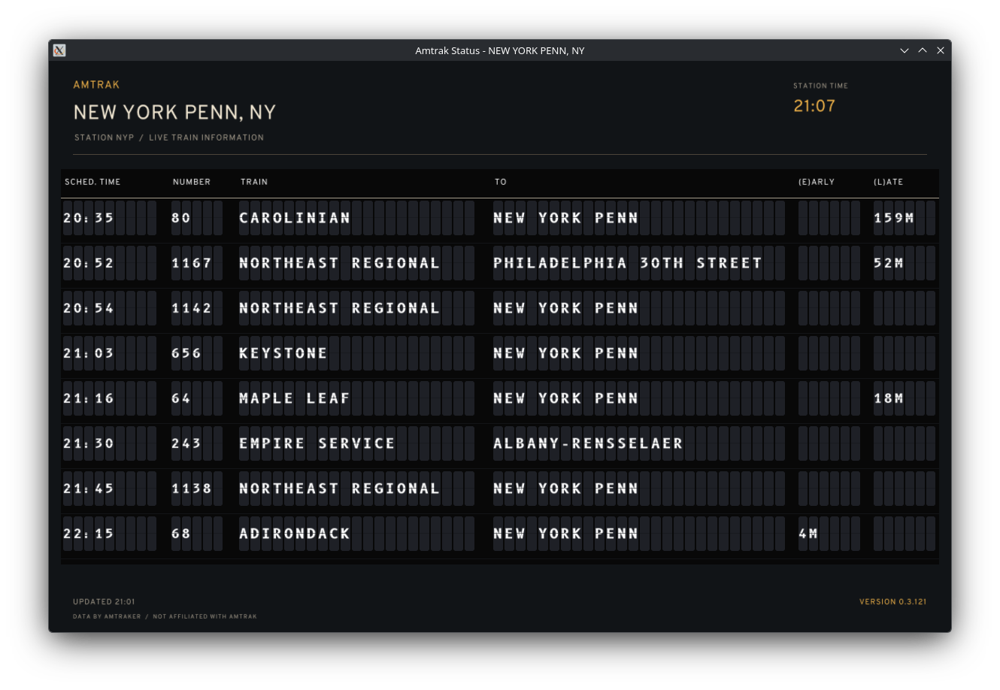

<p align="center">
    
    
</p>

## 🔍 Background

See [background.md](./background.md).

## 🛠️ Building

```sh
swift run AmtrakStatus
swift test
```

On Linux, building needs the X11 and GL development headers, and running needs `libxml2.so.2` for Hudini's XML reader.

The board opens on Ashland, VA (ASD). To open on another station, pass its code, as in `swift run AmtrakStatus --station NYP` (or `-s NYP`). To show only trains due soon, add `--hours` with how many hours ahead to look, such as `--hours 6`. Late trains stay until they depart. To get a station's trains in the terminal instead, add `--print`. It writes every train as tab-separated text, with a header line, and exits without opening a window. The app only logs warnings and errors unless you add `--verbose` (or `-v`). Amtraker's responses are kept in your cache folder (`~/.cache/AmtrakStatus` on Linux, `~/Library/Caches/AmtrakStatus` on macOS), so starting again or switching back to a station within the refresh interval doesn't fetch everything again. When Amtraker can't be reached, the board shows the last saved data and says how old it is. Deleting the folder is always safe. Click the station name to change stations. Press Escape to close the picker, or to quit from the board.

To build the packages for Linux, Windows, and macOS, see [`packaging`](packaging/README.md).

## ⚖️ License

I license this project under the GPL-3.0 license - see [LICENSE](LICENSE) for details.

The fonts are under the [SIL Open Font License 1.1](https://openfontlicense.org), each with its licence beside it in [`Sources/AmtrakStatus/Interface`](Sources/AmtrakStatus/Interface):

- [B612 Mono](https://github.com/polarsys/b612), by the B612 Project Authors, on the split-flap tiles.
- [Overpass](https://github.com/RedHatOfficial/Overpass), by the Overpass Project Authors, for everything else.

## ⚠️ Disclaimer

_This project is not in any way affiliated with Amtrak._
